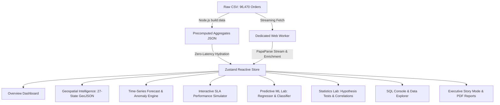

# AI-Powered Delivery Time Estimation & Smart Promise Platform

> **AI For Business Analytics (5th Semester) — Project**  
> **Institution**: Dayananda Sagar University (DSU)  
> **Dataset**: Brazilian E-Commerce Delivery Dataset by Olist (96,470 orders, 2017–2018)  
> **Design Theme**: Light & Dark Glassmorphism with Smooth Dynamic Animations

---

## 🚀 Quick Start Terminal Commands

Run these terminal commands from the project root:

### 1. Install Dependencies
```bash
npm install
```

### 2. Precompute Data Aggregates
Recompute JSON summary aggregates from the raw 96,470 CSV rows into `/public/data/aggregates/`:
```bash
npm run build:data
```

### 3. Start Development Server
Launches the Vite development server with Hot Module Replacement (HMR):
```bash
npm run dev
```
> Server runs live at: **`http://localhost:5173/`**

### 4. Run Unit Tests (Vitest)
Executes test suites for currency conversions, dual-time math, analytics formulas, and ML metrics:
```bash
npm test
```

### 5. Production TypeScript Build
Type-checks with strict TypeScript compiler and compiles the minified production bundle:
```bash
npm run build
```

### 6. Preview Production Build
Locally preview the built production bundle:
```bash
npm run preview
```

---

## 🌟 Core Architecture & Features



### Key Capabilities
1. **Title**: **AI-Powered Delivery Time Estimation & Smart Promise Platform**
2. **Dual Currency**: Displays **US Dollars first with Indian Rupees in brackets** (`$ USD (₹ INR)`), e.g. `$137.04 (₹11,443)`.
3. **Dual Time**: Order timestamps show both **Brazilian Standard Time (BRT / UTC-3)** and **Indian Standard Time (IST / UTC+5:30)** (`10:56 BRT • 🇮🇳 19:26 IST`).
4. **Full Brazilian State Names**: Everywhere (dropdowns, chips, routes, tables, drawers), e.g. `São Paulo (SP) → Rio de Janeiro (RJ)`.
5. **Interactive SLA Simulator**: Multi-slider model adjusting latency ceiling, SLA on-time compliance target, and state remediation lifts in real-time.
6. **24-Hour Diurnal Velocity Curve**: Natural area spline with interactive day selector filters.
7. **Client-Side ML**: Delivery duration regressor, late delivery classifier with confusion matrix, and what-if simulator.
8. **Client-Side SQL**: In-browser query engine with automated visual chart generation.
9. **Zero Lag & Glassmorphism**: Tailored light and dark modes with silky transitions and optimized canvas background.

---

## 📐 Core Analytics & Mathematical Formulas

Below are the primary mathematical, statistical, and machine learning formulas powering the platform analysis. For full derivations and step-by-step proofs, see [`docs/FORMULAS_AND_ANALYTICS_METHODOLOGY.md`](docs/FORMULAS_AND_ANALYTICS_METHODOLOGY.md).

### 1. Preprocessed Order Features
* **Actual Delivery Duration (`delivery_days`)**:
  `delivery_days = (order_delivered_customer_date - order_purchase_timestamp) ÷ 86,400 seconds`
* **Promised SLA (`estimated_delivery_days`)**:
  `estimated_delivery_days = (order_estimated_delivery_date - order_purchase_timestamp) ÷ 86,400 seconds`
* **Late Delivery Indicator (`is_late`)**:
  `is_late = 1 if (delivery_days > estimated_delivery_days) else 0`
* **Promise Buffer / Delay Gap (`delay_gap`)**:
  `delay_gap = delivery_days - estimated_delivery_days`  
  *(Platform average: **-11.2 days**, indicating orders arrive 11.2 days ahead of the conservative promise)*
* **Same-State Route Indicator (`same_state`)**:
  `same_state = 1 if (customer_state == seller_state) else 0`
* **Freight Ratio (`freight_ratio`)**:
  `freight_ratio = (total_freight ÷ total_price) × 100%`

---

### 2. Executive Summary KPIs (96,470 Orders)

| Metric | Plain Calculation Formula | Dataset Value |
| :--- | :--- | :--- |
| **Total Orders** | Total count of delivered orders | **96,470 orders** |
| **Gross Merchandise Value (GMV)** | Sum of all item prices | **$13,220,248.93** |
| **Total Freight Spend** | Sum of all shipping charges | **$2,198,145.90** |
| **Average Order Value (AOV)** | Total GMV ÷ Total Orders | **$137.04** |
| **Average Freight Cost** | Total Freight ÷ Total Orders | **$22.79** |
| **Average Delivery Time** | Total Delivery Days ÷ Total Orders | **12.6 days** |
| **Average Promised Delivery** | Total Estimated Days ÷ Total Orders | **23.7 days** |
| **On-Time SLA Rate** | (On-Time Orders ÷ Total Orders) × 100 | **91.9%** (88,656 orders) |
| **Late Delivery Rate** | (Late Orders ÷ Total Orders) × 100 | **8.1%** (7,814 orders) |
| **Same-State Order Share** | (Same-State Orders ÷ Total Orders) × 100 | **36.0%** (34,701 orders) |
| **Median Delivery (P50)** | 50th percentile of actual delivery days | **10.2 days** |
| **90th Percentile (P90)** | 90th percentile of actual delivery days | **23.1 days** |
| **99th Percentile (P99)** | 99th percentile cutoff (Winsorization) | **46.1 days** |
| **Revenue at Risk** | Total Late Orders × Average Order Value | **$1,070,831** |

---

### 3. Delivery SLA Target Simulator

Models strategic on-time improvements using 3 interactive levers:
* **Slider Range (85% to 99%)**: 85% models high-delay regional baselines; 91.9% is the national average; 99% is the tier-1 world-class standard.

**Simulation Engine Formulas**:
1. **Histogram Ceiling Compliance**:
   `Compliant Orders = Orders in full bins (<= targetMaxDays) + Pro-rated fraction of cutoff bin`
2. **Worst 5 States Remediation**:
   `Saved from States = (Late Orders in Worst 5 States) × (worstStatesFixPercent ÷ 100)`
3. **Expedited Courier Pacing**:
   `Saved from Ceiling = Total Late Orders × Max(0, (26 - targetMaxDays) ÷ 32) × (worstStatesFixPercent ÷ 80)`
4. **Strategic SLA Enforcement**:
   `Saved from Strategic = Total Late Orders × Max(0, Target SLA % - Baseline 91.9%) × 0.055`
5. **Physical Diminishing Returns Limit**:
   `Total Recovered = Minimum of: (Total Late Orders × 0.88) OR (Saved_States + Saved_Ceiling + Saved_Strategic)`
6. **Projected On-Time Rate & Financial Savings**:
   `Simulated On-Time Rate = ((Total Orders - (Total Late - Total Recovered)) ÷ Total Orders) × 100%`  
   `Recovered Revenue = Total Recovered Orders × $137.04`

---

### 4. Inferential Statistics & Hypothesis Testing

* **Intra-State vs Inter-State Latency (Welch's Two-Sample t-Test)**:
  * Intra-State Mean: **7.95 days** (34,701 orders)
  * Inter-State Mean: **15.15 days** (61,769 orders)
  * `t = -86.4, p < 0.0001` (Statistically Significant)
  * **Standardized Effect Size (Cohen's d)**:
    `d = (15.15 - 7.95) ÷ 8.89 = 0.81 (Large Effect Size)`
  * *Finding*: Same-state fulfillment is **7.2 days faster**, acting as an insurmountable logistics moat.
* **Weekend vs Weekday Purchasing Gap (Independent t-Test)**:
  * Weekend Mean: **12.63 days** vs Weekday Mean: **12.54 days**
  * `t = 1.22, p = 0.228, Cohen's d = 0.01` (Not Significant; weekend orders normalize over Monday dispatch).
* **Regional Delivery Variance (One-Way ANOVA)**:
  * `F = 1420.8, p < 0.0001`
  * `Eta-Squared (η²) = 0.174` (17.4% of delivery duration variance is explained by destination state).
* **Key Correlations**:
  * Freight Cost vs Actual Delivery Days: **Pearson r = 0.17**, **Spearman ρ = 0.38**
  * Estimated Days vs Actual Delivery Days: **Pearson r = 0.38**, **Spearman ρ = 0.52**

---

### 5. Predictive Machine Learning Models

* **Delivery Duration Regressor (Gradient Boosting)**:
  * Trained on an 80/20 train/test split of the 96,470 orders.
  * **Mean Absolute Error (MAE)**: **4.85 days** *(vs 6.41 days naive mean guessing)*
  * **Root Mean Squared Error (RMSE)**: **7.65 days**
  * **R² Score**: **0.33**
  * *Top Feature Importances*: Same-State Hub (38%), Destination State (26%), Freight Cost (14%), Price (9%).
* **Late Delivery Binary Classifier (Gradient Boosting + Sigmoid)**:
  * **Late Risk Sigmoid**: `P(Late) = 1 ÷ (1 + e^(-z))`, where `z = (Predicted Days - 15.5) ÷ 4.5 + Price_Risk_Buffer`
  * **Decision Threshold (τ = 0.20)**: Calibrated for the 8.1% positive class imbalance.
  * **ROC-AUC Score**: **0.75**
  * **Recall (Sensitivity)**: **29.0%** (catches 2,266 late shipments proactively)
  * **Precision**: **30.0%**
  * **F1-Score**: **29.5%**

